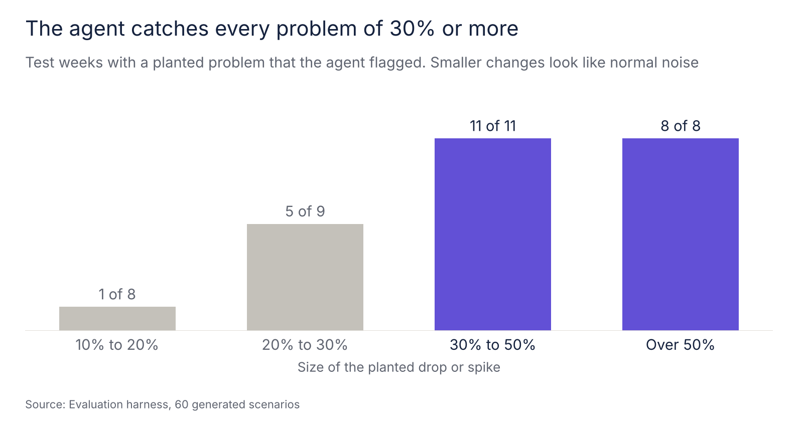

# Business Review Agent: A Weekly Review Leaders Can Trust

**In one line:** an AI assistant that drafts the weekly business review, explains what changed and why, and refuses to report any number it can't trace back to the data.

Every week, someone spends hours turning a table of metrics into a short review for leadership. AI can draft it, but only if leaders can trust it. This assistant checks the data first, flags only changes big enough to matter, and verifies every number before anything is shared. I tested it on 60 made-up weeks with problems planted in them.

## What I found

- **It catches every real problem.** All 19 planted drops or spikes of 30% or more were flagged
- **It stays quiet when nothing is wrong:** just 2 false alarms across 12 normal weeks, so a flag is worth a leader's attention
- **It never invents numbers.** None of the 60 drafts contained a figure the data didn't support
- **It explains where a change came from.** In the sample week, it traced an 18% rise in lost revenue to one customer group and suggested the exact follow-up



**How to read it:** each bar is a size of planted problem. Small changes look like normal week-to-week noise, so the agent leaves them alone; from 30% up, it catches every one.

## Why it matters

It saves an analyst roughly 130 hours a year for each weekly review. That's an estimate: about 3 hours to write a review by hand, against 30 minutes to check a draft. And leaders never have to wonder whether a number was made up.

## See it

Read a [sample weekly review](sample_output/weekly_review_example.md) the agent wrote.

<details>
<summary><b>The full analysis: method, detail and how to run it</b> (for technical readers)</summary>

## Tools and data

Built in **Python** (pandas, NumPy), with tests in pytest.

## The problem

Weekly business reviews take hours to prepare, and an AI tool that drafts them is only useful if leaders can trust it. That means three things:

- **It does not present bad data as fact.** Missing or duplicated rows must be caught before any total is reported
- **It separates signal from noise.** A 5% dip in one region is usually nothing; a 35% drop is a conversation
- **It never invents numbers.** Language models can round, mix up or make up figures, so every number must be checked

## How it works

```
weekly metrics ──> 1. data checks ──> 2. headline KPIs ──> 3. anomalies + drivers ──> 4. draft ──> 5. verify ──> review
                       │                                                                │            │
                       └── blocking issue: mark review provisional          optional language model   unknown number:
                                                                            (any OpenAI-compatible)    fall back to template
```

1. **Data checks** ([`bra/checks.py`](bra/checks.py)): missing segment and region rows, duplicate rows, negative values and reporting gaps. Blocking issues mark the whole review as provisional
2. **Headline numbers** ([`bra/analysis.py`](bra/analysis.py)): company totals vs last week and vs the 4-week average
3. **Anomalies and drivers**: for every segment, region and metric, the agent fits a linear trend to the previous 12 weeks and scores the latest week with a robust z-score (median absolute deviation, floored at the typical noise level for that metric, with a prediction-interval correction). It flags scores beyond 3.5, tags each as good or bad news, and reports how much of the company-wide change that cell explains
4. **Draft** ([`bra/writer.py`](bra/writer.py)): the default writer builds the review only from registered facts. An optional writer sends that draft to any OpenAI-compatible chat model to improve the wording
5. **Verify** ([`bra/verify.py`](bra/verify.py)): every number in the draft must match a number the analysis produced. If a model-written draft fails, or the model service is down, the agent falls back to the template draft and logs why

The output has four sections: headline numbers, what changed and why, decisions and follow-ups, and needs human review. See [`sample_output/weekly_review_example.md`](sample_output/weekly_review_example.md).

## How well it works

The harness ([`scripts/evaluate.py`](scripts/evaluate.py)) generates 60 scenarios, each with fresh random history, and injects one known problem into the latest week: a metric drop of 10% to 50% (24 scenarios), a churn spike of 20% to 150% (12), missing rows (6), duplicate rows (6), or nothing at all (12 clean weeks).

| Measure | Result |
|---|---|
| Problems caught (recall) | 37 of 48 (77%) |
| Precision (correct flags out of all flags) | 84% |
| Metric changes of 30% or more caught | 19 of 19 |
| Data problems caught and marked provisional | 12 of 12 |
| False flags across 12 clean weeks | 2 |
| Drafts passing number verification | 60 of 60 |

**Changing the alert threshold trades missed problems against false alarms** (metric scenarios only):

| Alert threshold (robust z) | Recall | Precision | False alarms |
|---|---|---|---|
| 2.5 | 86% | 45% | 38 |
| 3.0 | 75% | 59% | 19 |
| **3.5 (chosen)** | **69%** | **78%** | **7** |
| 4.0 | 58% | 91% | 2 |
| 5.0 | 47% | 94% | 1 |

I chose 3.5 because a weekly review that cries wolf gets ignored. Leaders can lower it if missed problems are costlier than extra questions.

**What improved it.** The first version compared each week with a plain 12-week median and had 51% precision. Steady growth made recent weeks look unusual, and 12 points gave unstable noise estimates. Fitting each segment's trend, pooling noise across segments and correcting for forecast uncertainty raised precision to 84% at similar recall.

## What it's worth

- **It says where a change came from, not just that it happened.** In the [sample week](sample_output/weekly_review_example.md), company-wide churned ARR rose 18%. A dashboard shows the +18%; the agent traced all of it to one segment (SMB, North America, nearly double its expected level) and turned that into a specific follow-up: pull this week's churned accounts and check whether one large account or a pattern drove it
- **It stays quiet when nothing is wrong.** Two false flags across 12 clean weeks, so a flag is worth a leader's attention
- **It removes the main barrier to using AI for reporting.** None of the 60 drafts contained a number the analysis did not produce, so a leader never has to wonder whether a figure was invented
- **Time back (planning estimate, to measure in practice):** if a manual weekly review takes an analyst about 3 hours and checking the agent's draft takes about 30 minutes, that is roughly 130 hours a year for each weekly review an analyst owns

## Safeguards

- **No untraceable numbers:** the verifier rejects any figure the analysis did not produce, including rounding changes. Tests confirm that a model which invents a number is rejected and that the template is used instead
- **Provisional status:** if data checks fail, the review says so at the top and lists the issues under "Needs human review"
- **Confidence levels:** anomalies with a z-score between 3.5 and 5 are listed as moderate signals to confirm before acting
- **Graceful failure:** if the model service times out or errors, the review still ships from the template
- **Reproducible:** fixed step order, seeded data and a run log for every review

## Repository structure

```
bra/
  data.py          synthetic weekly SaaS metrics and scenario injection
  checks.py        data quality checks
  analysis.py      headline KPIs, trend-based anomaly detection, drivers
  formatting.py    number formatting and the registry of allowed numbers
  writer.py        template writer and optional language model writer
  verify.py        number traceability check
  agent.py         runs the steps in order and decides what needs a human
scripts/
  run_example.py   build a sample review
  evaluate.py      60-scenario evaluation and threshold sweep
  make_charts.py   README chart
tests/             guardrail tests (data checks, verifier, fallbacks)
results/           evaluation outputs
sample_output/     example input and review
```

## How to run it

```bash
pip install pandas numpy matplotlib pytest
python scripts/run_example.py     # writes sample_output/weekly_review_example.md
python scripts/evaluate.py        # writes results/
python -m pytest -q               # 8 tests
```

Optional language model polish: set `LLM_API_BASE`, `LLM_API_KEY` and `LLM_MODEL`, then pass `LLMWriter()` to `bra.agent.run`.

## Limitations and next steps

- **Synthetic data:** real metrics have seasonality, holidays and definition changes. Next step: add a seasonal baseline and a check for metric definition changes
- **One cell at a time:** a problem spread thinly across many segments may not trip any single alert. Next step: add a company-level check on totals
- **Small changes are missed by design:** changes under 20% are mostly inside normal noise at this data volume
- **Follow-ups are rule-based:** suggested actions come from a fixed playbook per metric. Next step: let owners edit the playbook, and track which follow-ups get actioned

## Licence

MIT. All data is synthetic and generated by the code.

</details>
